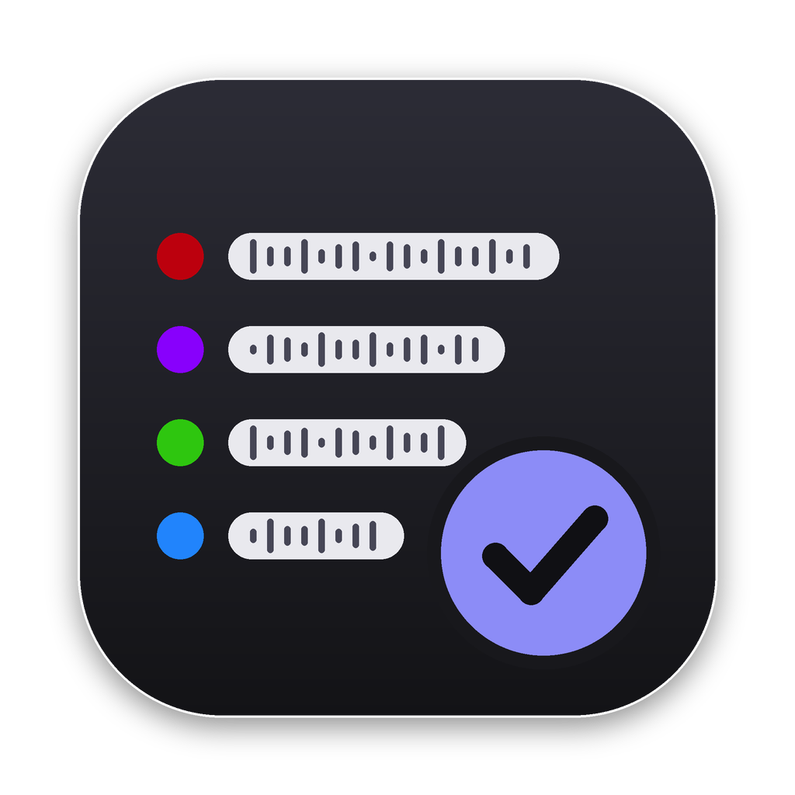
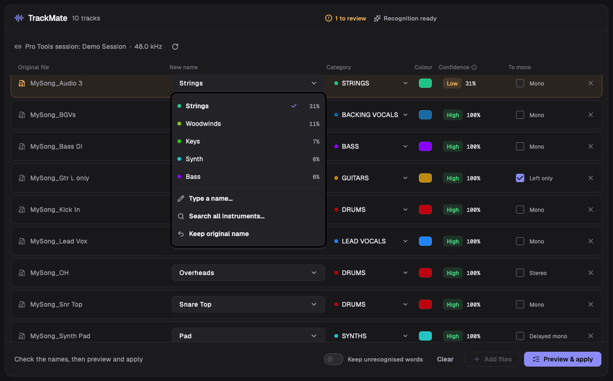
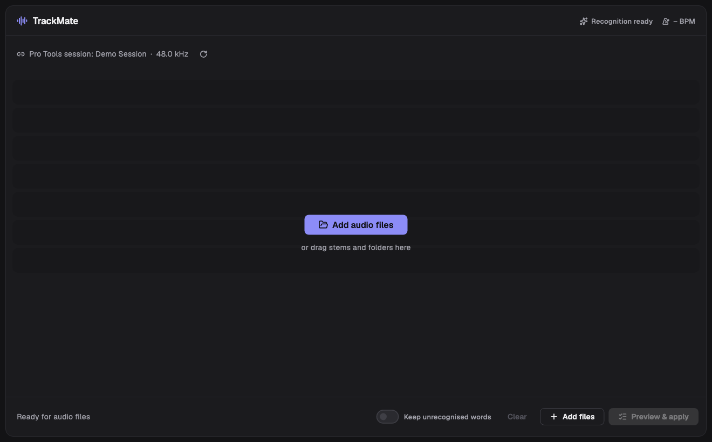
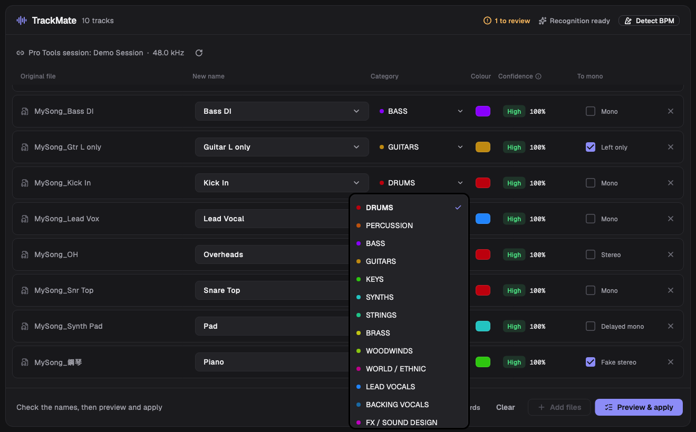
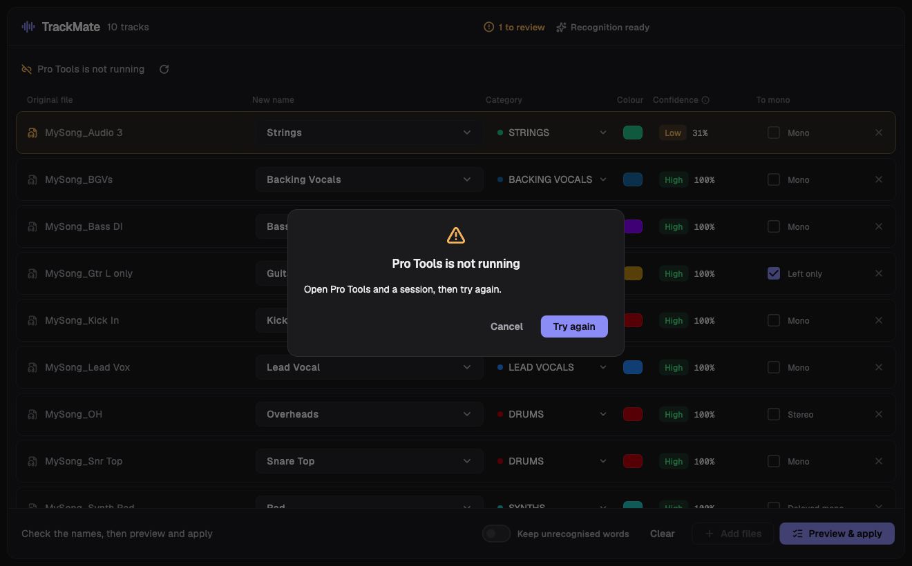

<p align="center"></p>

# TrackMate（音軌助手）

TrackMate 要解決 Pro Tools 混音前最瑣碎的整理工作：分軌檔名五花八門、充滿錯字和縮寫，還有本來是單聲道、卻被輸出成立體聲的軌道。

它會自動辨識每一軌是什麼樂器，給出標準名稱、大類和顏色，並判斷要不要還原成 mono；經你確認後，一鍵匯入 Pro Tools，依大類建資料夾、匯入、改名、上色。

辨識結合規則與 AI 模型：
- **規則：** 常用軌名字典和拼字校正。
- **讀名稱：** 用支援多語言的文字嵌入模型 Qwen3-Embedding-0.6B，理解沒看過的軌名。
- **聽聲音：** 用 Meta 預訓練的音訊–文字模型 PE-AV（與 CLAP 同類，只取音訊端並轉成 ONNX），判斷名稱看不出來的軌。

在真實軌名的測試中，Top-1 準確率為 96.6%，正確答案出現在前 5 名的比例為 98.9%。

匯入 Pro Tools 時，不靠 AppleScript 模擬滑鼠點擊，而是透過 Avid 官方的 Pro Tools Scripting Library（PTSL）操作，比較不受介面改版影響，未來版本的相容性也更好。



- **四層辨識：** 已知軌名字典 → 拼字校正 → AI 讀名稱 → 聽聲音。中、英、日文名稱都能辨識；名稱看不出來的軌（例如 `Audio 3`），會改用音訊判斷。
- **有疑問的地方交給你決定：** 每一軌顯示 Top-1 和信心程度；下拉選單列出 Top-5，也可以自己打名稱、搜尋全部樂器、保留原名，或改大類和顏色。
- **立體聲分析：** 偵測假立體聲、單邊立體聲、極性反相和延遲，需要時自動轉成 mono。
- **Pro Tools 整合：** 透過 PTSL 操作。名稱自動避開重複，套用後逐軌驗證名稱、資料夾和顏色。
- **完全在本機執行：** 模型第一次啟動時下載，之後不需要網路。

---

## 目錄
- [下載與安裝](#下載與安裝)
- [使用方法](#使用方法)
- [演算法邏輯](#演算法邏輯)
- [系統架構](#系統架構)
- [從原始碼建置與測試](#從原始碼建置與測試)
- [專案結構](#專案結構)
- [研究與測試報告](#研究與測試報告)
- [CI/CD](#cicd)
- [已知限制](#已知限制)
- [致謝](#致謝)

---

## 下載與安裝

### 系統需求
| 項目 | 需求 |
|---|---|
| macOS | Apple Silicon（M 系列），macOS 12 以上 |
| Windows | Windows 10/11 x64（目前只在 CI 上建置，還沒在實機上驗證，見[已知限制](#已知限制)） |
| Pro Tools | 支援 PTSL 的版本（2023.3 以上）；測試環境是 Pro Tools 26.4.1。上色需要支援 `SetTrackColor` 的 PTSL |
| 磁碟空間 | App 約 150 MB；第一次啟動會再下載約 1.35 GB 的模型 |

### 安裝
1. 到 [Releases](../../releases) 下載最新版本：
   - macOS：`TrackMate-macos-arm64.dmg`（或 `.zip`）
   - Windows：`TrackMate-windows-x64.zip`
2. **macOS：** 把 `TrackMate.app` 拖進「應用程式」資料夾。目前的版本沒有經過 Apple 公證，第一次開啟時請在 App 上按右鍵 →「打開」；也可以在終端機執行：
   ```bash
   xattr -dr com.apple.quarantine /Applications/TrackMate.app
   ```
3. **Windows：** 解壓縮後執行 `TrackMate.exe`。如果出現 SmartScreen 警告，按「其他資訊」→「仍要執行」。
4. **第一次啟動：** App 會在背景下載模型，標題列會顯示下載進度。下載完成前，「已知軌名」和「拼字校正」兩種辨識方式就已經可以使用。模型和設定存放在：
   - macOS：`~/Library/Application Support/TrackMate`
   - Windows：`%APPDATA%\TrackMate`

## 使用方法



1. **開啟 Pro Tools 和要匯入的 session。** 標題下方會顯示目前的 session 名稱和取樣率。
2. **加入分軌：** 把音檔或資料夾拖進視窗，或按「Add audio files」。支援 WAV、AIFF、MP3、FLAC、M4A、OGG、CAF。
3. **檢查辨識結果：**
   - 先顯示依名稱辨識的結果；名稱看不出來的軌，接著會「聽聲音」再判斷（顯示 *Listening…*）。
   - 信心低的軌會用橘色底標出，標題列會顯示待確認的軌數。滑鼠停在信心欄上，可以看到這一軌是怎麼辨識的。
4. **修正：**
   - **新名稱欄的下拉選單（Top-5）：** 可以選其他候選，或選 *Type a name…*（自己輸入）、*Search all instruments…*（搜尋全部樂器）、*Keep original name*（保留原名）。名稱欄也可以直接編輯。
   - **Category：** 改大類，顏色會跟著換成該大類的預設顏色。
   - **顏色方塊：** 從 Pro Tools 的 69 色調色盤挑顏色。
   - **To mono：** 依立體聲分析的建議預設勾選，可以自己改。
   - 你從 Top-5 改選的樂器會被記住，下次遇到同樣的名稱會直接辨識正確。
5. **Keep unrecognised words（預設關閉）：** 關閉時，無法辨識的字和 Pro Tools 的後綴（例如 `_04-01`、`-TCEx_01`）會被刪掉；打開後保留。名稱重複時會自動加上流水號，例如 `Lead Vocal 1`、`Lead Vocal 2`。
6. **按「Preview & apply」：** 先預覽會建立哪些資料夾、每軌的最終名稱和是否轉 mono，確認後才寫入 Pro Tools。完成後，每一軌會顯示驗證結果。



遇到問題時，App 會跳出提醒視窗並告訴你怎麼處理：



| 情況 | 提醒 | 可以做什麼 |
|---|---|---|
| Pro Tools 沒開 | Pro Tools is not running | 開好 Pro Tools 後按 *Try again* |
| 沒有開 session | No session is open in Pro Tools | 開好 session 後按 *Try again* |
| Pro Tools 忙碌或有對話框 | Pro Tools is not responding | 關掉對話框後按 *Try again* |
| 套用途中 Pro Tools 關閉 | Pro Tools stopped during the import | 先檢查 session（可能已經建立了部分軌道），再重新套用 |
| 檔案被移走 | Files not found（列出檔案） | 辨識時會自動移除這幾軌 |
| 拖進來的東西沒有音檔 | No audio files found | — |
| 引擎停止 | The TrackMate engine stopped | *Restart engine*（清單會保留） |

## 演算法邏輯

### 1. 名稱前處理
程式：[`engine/stem_engine/names.py`](engine/stem_engine/names.py)

1. **正規化：** 做 Unicode NFKC 正規化，去掉副檔名、BPM、調性和日期。
2. **去掉 Pro Tools 加的後綴**（反覆處理，直到沒有為止）：
   - take 和 clip 編號，例如 `_03`、`_04-01`。
   - 播放清單編號，例如 `.04_09`。
   - 重複檔標記，例如 `.dup1`。
   - AudioSuite 處理標記：`-標記` 後面接 take 編號，而且字典不認得那個字，例如 `-TCEx_01`。
3. **斷詞：** 依分隔符號、大小寫（`SnareTop`）、字母和數字的邊界、中日文和英文的邊界斷開。保留原本的拼寫，方便必要時原樣保留。
4. **刪掉整批共同的前後綴：** 整批檔案都有的前綴和後綴通常是歌名（例如 `MySong_`、`_Track1`），會被刪掉；但字典認得的詞會保留。
5. **辨認 DAW 預設名稱：** `Audio 7`、`Untitled`、`オーディオ 3` 這類名稱看不出樂器，直接交給音訊判斷，也不保留 DAW 自動編的號碼。

### 2. 四層辨識
| 層 | 方法 | 程式 | 採用條件 |
|---|---|---|---|
| A 已知軌名 | [`kb/mix_naming.json`](kb/mix_naming.json)：14 個大類、191 種樂器、約 2,100 個中英日文別名和縮寫，再加上你修正過的別名 | [`textmatch.py`](engine/stem_engine/textmatch.py) | 命中就採用（信心高） |
| B 拼字校正 | rapidfuzz WRatio，用在沒辨識出的字 | 同上 | 分數 ≥ 90、長度 ≥ 4、領先第二名 ≥ 5 分，而且兩者長度相近（信心中） |
| C AI 讀名稱 | Qwen3-Embedding-0.6B（ONNX 8-bit）。查詢和索引都加上同一段指令，索引中另有一組「非樂器」反例錨點 | [`embed.py`](engine/stem_engine/embed.py) | 相似度 ≥ 0.86、領先 ≥ 0.03，而且高於反例錨點（信心中）；0.62–0.86 交給 D 層確認大類 |
| D 聽聲音 | PE-AV small 音訊編碼器（ONNX 8-bit），取最大聲的片段，和 16 個類別原型比對（12 個大類、click、整首混音、說話、雜訊），用 SigLIP logit 加 softmax 計分 | [`audio.py`](engine/stem_engine/audio.py) | 最佳類別的機率 ≥ 0.15（只判斷大類，信心低） |

**字典比對的細節：**
- 最長片語優先（`bass drum` 會先比對成 kick，而不是 bass）。
- 縮寫必須是完整的字；中日文用子字串比對，最長的優先。
- 同時是樂器和修飾詞的字（例如 `room`、`dbl`），旁邊有其他樂器字時當修飾詞，單獨出現時才當樂器。
- 單一字母只有在它是整個名稱時才算數。
- 多種大類同時出現時，交給音訊判斷。

**合併（[`pipeline.py`](engine/stem_engine/pipeline.py)）：**
- 字典只認出大類詞、名稱裡又有其他字時（`Synthesized Bass`），如果 AI 的第一名是同一大類下更細的樂器，就改用 AI 的答案（A+C）。
- AI 落在灰色區時，音訊判斷的大類和 AI 一致才採用（C+D）。
- 都辨識不出來時，大類標成 OTHER，保留原名並標記待確認。
- Top-5 候選依序來自：決定的答案 → 字典的歧義選項 → AI 的排名（用音訊大類機率調整排序）→ 音訊大類的代表樂器。分數以百分比顯示，但意思依來源不同：字典 100%、AI 為相似度、音訊為機率。

### 3. 命名規則
- **組成：** 標準名稱 ＋ 修飾詞 ＋ 編號，例如 `Snare Bottom 2`。
  - 位置類修飾詞會標準化：L/R/C、Top/Bottom、In/Out、DI/Amp。
  - 其他修飾詞保留你原本的寫法，例如 `Fuzz`。
- **保留模式：** 打開「Keep unrecognised words」時，會加回無法辨識的字和 Pro Tools 後綴。
- **重複名稱：** 同一批名稱重複時加上流水號；名稱結尾已經是數字時用 `-1/-2`。
- **和 session 撞名：** 和 Pro Tools 裡既有的軌撞名時，自動改成 ` 2`、` 3`（區分大小寫，和 Pro Tools 一致）。

### 4. 立體聲判斷
程式：[`stereo_analysis/stereo_analyzer.py`](stereo_analysis/stereo_analyzer.py)

- **原理：** 單一來源不論 Pan、Pan law 或極性為何，(L, R) 的樣本都落在一條通過原點的直線上，所以用 2×2 共變異數的 rank-1 殘差 `10·log10(λmin/λmax)` 來判斷。
- **還原 mono：** 主特徵向量給出 Pan 位置和極性；投影到主特徵向量上，就得到不會抵銷的 mono 版本。
- **只看有聲音的片段：** 只統計有聲音的音框，不受靜音和淡入淡出影響。
- **其他偵測：** 交叉相關會找出延遲的 mono。

詳細說明見[立體聲報告](docs/reports/stereo-analysis.md)。

### 5. 匯入 Pro Tools（`/apply`）
程式：[`engine/stem_engine/apply.py`](engine/stem_engine/apply.py)、[`protools.py`](engine/stem_engine/protools.py)

1. **資料夾：** 依大類順序建立 Basic Folder；session 裡已有同名資料夾時沿用。
2. **匯入：** 逐檔匯入（ConvertAudio，自動轉成 session 的取樣率），每次先選取前一軌，讓資料夾裡的順序和清單一致；需要轉 mono 的檔案先轉成暫存檔。
3. **改名：** 用匯入前後的 track ID 差異找出新軌，立刻改成事先確認過不重複的名稱。
4. **上色：** 依顏色把資料夾和軌分組後上色。
5. **驗證：** 重新讀取音軌清單，逐軌確認名稱、資料夾和顏色。

PTSL 目前沒有建立 bus 的指令，所以不自動設定輸出路由，詳見[整合報告](docs/reports/pro-tools-integration.md)。

## 系統架構

```
┌─────────────── TrackMate（Flutter：macOS / Windows）───────────────┐
│ 拖放與選檔（Swift / C++） │ 分軌清單、Top-5、顏色 │ 預覽與提醒    │
└───────────────┬─────────────────────────────────────────────────────┘
                │ HTTP，只綁 127.0.0.1，每次啟動產生新 token
┌───────────────▼──────────── 本機引擎（Python，PyInstaller 打包）──────┐
│ 名稱前處理 → A/B/C/D → 合併 │ 立體聲分析 │ 模型下載與校驗 │ 別名學習 │
│ onnxruntime：Qwen3-Embedding、PE-AV 音訊編碼器                       │
└───────────────┬─────────────────────────────────────────────────────┘
                │ gRPC（PTSL，localhost:31416）
┌───────────────▼─────────────────────────────────────────────────────┐
│ Pro Tools：讀 session、建資料夾、匯入、改名、上色                     │
└─────────────────────────────────────────────────────────────────────┘
```

- **啟動：** App 啟動時，以子程序啟動內建的引擎，從引擎的第一行輸出或 `engine.json` 取得 port 和 token。
- **API 安全：** 只接受本機連線；每次啟動產生新的 token；Host 不是本機的請求一律拒絕。端點說明見 [`engine/README.md`](engine/README.md)。

## 從原始碼建置與測試

需要的工具：
- [uv](https://docs.astral.sh/uv/)（Python 3.12）。
- [Flutter 3.47.8](https://docs.flutter.dev/)。
- macOS 需要 Xcode；Windows 需要 Visual Studio 2022（含 C++ 桌面開發）。
- 本機要有 Pro Tools 才能跑整合測試。

```bash
# 引擎
cd engine
uv sync --group dev
uv run pytest -q                       # 80 個測試（需要模型的整合測試會自動跳過）
uv run stem-engine                     # 啟動，第一行輸出 {"port", "token"}，並開始下載模型

# 立體聲分析
cd ../stereo_analysis
../engine/.venv/bin/python -m pytest -q   # 27 個測試

# App（開發模式，連到上面的引擎環境）
cd ../app
flutter test                            # 25 個測試；截圖比對加上 --exclude-tags golden 可略過
flutter run -d macos --dart-define=ENGINE_CMD=$PWD/../engine/.venv/bin/stem-engine
```

**打包成可以發佈的 App：**
- macOS：執行 [`scripts/package-macos.sh`](scripts/package-macos.sh)。
- Windows：執行 [`scripts/package-windows.ps1`](scripts/package-windows.ps1)。
- 兩個腳本都會打包引擎、執行 smoke test、建置 App、把引擎放進 App，然後輸出到 `dist/`。

更多細節見 [`engine/README.md`](engine/README.md) 和 [`app/README.md`](app/README.md)。

## 專案結構

| 路徑 | 內容 |
|---|---|
| [`app/`](app) | Flutter 桌面 App：[介面](app/lib/ui)、[狀態](app/lib/app_state.dart)、[引擎啟動器](app/lib/engine/engine_launcher.dart)、[macOS 原生](app/macos/Runner/MainFlutterWindow.swift)、[Windows 原生](app/windows/runner/flutter_window.cpp)、[測試](app/test) |
| [`engine/`](engine) | 本機引擎：[辨識](engine/stem_engine)、[API](engine/stem_engine/api.py)、[Pro Tools](engine/stem_engine/protools.py)、[模型清單](engine/stem_engine/data/model_manifest.json)、[測試](engine/tests)、[評測工具](engine/tools)、[打包](engine/packaging) |
| [`stereo_analysis/`](stereo_analysis) | 立體聲／單聲道判斷與測試 |
| [`kb/mix_naming.json`](kb/mix_naming.json) | 樂器命名字典（大類、樂器、別名、縮寫、中日文、修飾詞、歧義詞） |
| [`experiments/`](experiments) | 研究：[語意比對模型比較](experiments/c_layer_embedding)、[樂器辨識評測](experiments/instrument_zeroshot) |
| [`tools/`](tools) | [Qwen ONNX 匯出](tools/qwen_onnx)、[PE-AV ONNX 匯出](tools/peav_onnx)、[Pro Tools 探測腳本](tools/ptsl_m0) |
| [`scripts/`](scripts) | macOS / Windows 打包腳本 |
| [`docs/`](docs) | [研究與測試報告](docs/reports)、[截圖](docs/images) |
| [`.github/workflows/`](.github/workflows) | [CI](.github/workflows/ci.yml)、[打包與發佈](.github/workflows/package.yml) |

## 研究與測試報告

報告索引：[`docs/reports/`](docs/reports/README.md)

| 報告 | 重點 |
|---|---|
| [語意比對模型比較](experiments/c_layer_embedding/REPORT.md) | Qwen3-Embedding 中文最好，bge-m3 日文最好；Top-5 涵蓋率明顯高於 Top-1，所以適合當候選清單 |
| [樂器辨識評測](experiments/instrument_zeroshot/REPORT.md) | PE-AV small 在真實獨奏片段的大類準確率 96.2%（平衡準確率 97.5%） |
| [模型匯出與量化](docs/reports/model-export.md) | 兩個 ONNX 模型和 PyTorch 的 cosine 都 ≥ 0.996；Qwen 8-bit CPU 每筆 54 ms |
| [立體聲／單聲道判斷](docs/reports/stereo-analysis.md) | 14 種合成情境（Pan、單邊、極性反相、延遲、殘響…）全部判斷正確 |
| [本機引擎評測](docs/reports/engine-evaluation.md) | 真實軌名 Top-1 96.6%、Top-5 98.9%；自動改名精確度 97.0%，非樂器名稱 0 誤改 |
| [Pro Tools 整合測試](docs/reports/pro-tools-integration.md) | 10 軌匯入、改名、上色 8.2 秒，全部通過驗證 |
| [桌面 App 測試](docs/reports/app-testing.md) | 真實 App ＋ 引擎 ＋ Pro Tools 端到端 35–38 秒 |

## CI/CD

| Workflow | 觸發時機 | 內容 |
|---|---|---|
| [CI](.github/workflows/ci.yml) | push 到 `main`、Pull Request | 引擎與立體聲分析的測試、`flutter analyze`、App 測試（不含截圖比對） |
| [Package](.github/workflows/package.yml) | push 到 `main`、`v*` 標籤、手動觸發 | 在 macOS（Apple Silicon）和 Windows 各自打包引擎並跑 smoke test，再建置 App，上傳成 Actions 產物；推送 `v*` 標籤時自動建立 GitHub Release 並附上安裝檔 |

發佈新版本：
```bash
git tag v0.1.0
git push origin v0.1.0
```

## 已知限制
- **輸出路由：** PTSL 目前不能建立 bus，所以只建立資料夾分組，輸出路由要自己設定。
- **Windows 版：** 在 CI 上編譯和打包，但還沒在實機上操作過；拖放時也不會顯示 hover 效果。
- **macOS 版：** 只支援 Apple Silicon；目前是 ad-hoc 簽章，沒有經過 Apple 公證。
- **門檻：** 目前的門檻是用小型測試集定出的起始值，還需要用真實 session 再校準。
- **字典：** 沒收錄的中日文寫法，主要靠擴充字典和你的修正來學習。
- **音訊辨識：** 只判斷大類，而且只用獨奏片段驗證過。CPU 處理每 10 秒片段約 2.8 秒，所以只對名稱看不出來的軌執行。

## 致謝

TrackMate 使用了下列開源軟體、模型、資料集和字型，感謝各作者與社群。各項目的授權以原專案為準。

### 模型
| 模型 | 作者 | 授權 | 用途 |
|---|---|---|---|
| [Qwen3-Embedding-0.6B](https://huggingface.co/Qwen/Qwen3-Embedding-0.6B) | Qwen 團隊（Alibaba） | Apache-2.0 | C 層 AI 讀名稱（ONNX 版：[aaatmy/Qwen3-Embedding-0.6B-ONNX](https://huggingface.co/aaatmy/Qwen3-Embedding-0.6B-ONNX)） |
| [PE-AV small](https://huggingface.co/facebook/pe-av-small)（Perception Encoder Audio-Visual） | Meta FAIR | Apache-2.0 | D 層聽聲音（ONNX 版：[aaatmy/pe-av-small-audio-ONNX](https://huggingface.co/aaatmy/pe-av-small-audio-ONNX)） |
| [multilingual-e5-small](https://huggingface.co/intfloat/multilingual-e5-small) | Microsoft | MIT | 研究比較 |
| [bge-m3](https://huggingface.co/BAAI/bge-m3) | BAAI | MIT | 研究比較 |
| [larger_clap_general](https://huggingface.co/laion/larger_clap_general) | LAION | Apache-2.0 | 研究比較 |

### 資料集
| 資料集 | 授權 | 用途 |
|---|---|---|
| [NSynth](https://magenta.tensorflow.org/datasets/nsynth)（Google Magenta） | CC BY 4.0 | 樂器辨識評測 |
| [Medley-solos-DB](https://zenodo.org/records/3464194)（Lostanlen & Cella） | CC BY 4.0 | 樂器辨識評測、音訊層門檻 |

### 引擎（Python）
| 套件 | 授權 |
|---|---|
| [NumPy](https://numpy.org/) | BSD-3-Clause |
| [python-soundfile](https://github.com/bastibe/python-soundfile)（內含 [libsndfile](https://libsndfile.github.io/libsndfile/)，LGPL-2.1） | BSD-3-Clause |
| [python-soxr](https://github.com/dofuuz/python-soxr)（[libsoxr](https://sourceforge.net/projects/soxr/)） | LGPL-2.1-or-later |
| [RapidFuzz](https://github.com/rapidfuzz/RapidFuzz) | MIT |
| [ONNX Runtime](https://onnxruntime.ai/) | MIT |
| [Hugging Face Tokenizers](https://github.com/huggingface/tokenizers) | Apache-2.0 |
| [FastAPI](https://fastapi.tiangolo.com/)、[Pydantic](https://docs.pydantic.dev/) | MIT |
| [Starlette](https://www.starlette.io/)、[Uvicorn](https://www.uvicorn.org/) | BSD-3-Clause |
| [py-ptsl](https://github.com/iluvcapra/py-ptsl)（Jamie Hardt） | BSD-3-Clause |
| [gRPC](https://grpc.io/)（grpcio） | Apache-2.0 |
| [Protocol Buffers](https://protobuf.dev/) | BSD-3-Clause |
| [PyInstaller](https://pyinstaller.org/)（打包；bootloader 例外條款允許散布打包後的程式） | GPL-2.0 with bootloader exception |
| [pytest](https://pytest.org/)、[HTTPX](https://www.python-httpx.org/)（測試） | MIT、BSD-3-Clause |
| [uv](https://docs.astral.sh/uv/)、[Hatchling](https://hatch.pypa.io/)（建置工具） | MIT / Apache-2.0、MIT |

研究和模型匯出另外使用了 [PyTorch](https://pytorch.org/)（BSD-3-Clause）、[Transformers](https://github.com/huggingface/transformers)、[Sentence Transformers](https://www.sbert.net/)、[timm](https://github.com/huggingface/pytorch-image-models)（Apache-2.0）、[librosa](https://librosa.org/)（ISC）、[Pillow](https://python-pillow.org/)（MIT-CMU）。

### App（Flutter）
| 項目 | 授權 |
|---|---|
| [Flutter](https://flutter.dev/)、[http](https://pub.dev/packages/http) | BSD-3-Clause |
| [lucide_icons_flutter](https://pub.dev/packages/lucide_icons_flutter)（[Lucide](https://lucide.dev/) 圖示，ISC） | MIT |
| [Geist、Geist Mono](https://github.com/vercel/geist-font)（Vercel，v1.8.2，授權檔見 [`app/assets/fonts/Geist-OFL.txt`](app/assets/fonts/Geist-OFL.txt)） | SIL OFL 1.1 |

### 引用文獻
```bibtex
@article{qwen3embedding,
  title   = {Qwen3 Embedding: Advancing Text Embedding and Reranking Through Foundation Models},
  author  = {Zhang, Yanzhao and Li, Mingxin and Long, Dingkun and Zhang, Xin and Lin, Huan and Yang, Baosong and Xie, Pengjun and Yang, An and Liu, Dayiheng and Lin, Junyang and Huang, Fei and Zhou, Jingren},
  journal = {arXiv preprint arXiv:2506.05176},
  year    = {2025}
}
@misc{vyas2025peav,
  title  = {Pushing the Frontier of Audiovisual Perception with Large-Scale Multimodal Correspondence Learning},
  author = {Vyas, Apoorv and Chang, Heng-Jui and Yang, Cheng-Fu and Huang, Po-Yao and Gao, Luya and Richter, Julius and Chen, Sanyuan and Le, Matt and Doll{\'a}r, Piotr and Feichtenhofer, Christoph and Lee, Ann and Hsu, Wei-Ning},
  year   = {2025},
  eprint = {2512.19687},
  archivePrefix = {arXiv}
}
@inproceedings{wu2023clap,
  title     = {Large-scale Contrastive Language-Audio Pretraining with Feature Fusion and Keyword-to-Caption Augmentation},
  author    = {Wu, Yusong and Chen, Ke and Zhang, Tianyu and Hui, Yuchen and Berg-Kirkpatrick, Taylor and Dubnov, Shlomo},
  booktitle = {ICASSP},
  year      = {2023}
}
@article{wang2024me5,
  title   = {Multilingual E5 Text Embeddings: A Technical Report},
  author  = {Wang, Liang and Yang, Nan and Huang, Xiaolong and Yang, Linjun and Majumder, Rangan and Wei, Furu},
  journal = {arXiv preprint arXiv:2402.05672},
  year    = {2024}
}
@article{chen2024bgem3,
  title   = {BGE M3-Embedding: Multi-Lingual, Multi-Functionality, Multi-Granularity Text Embeddings Through Self-Knowledge Distillation},
  author  = {Chen, Jianlv and Xiao, Shitao and Zhang, Peitian and Luo, Kun and Lian, Defu and Liu, Zheng},
  journal = {arXiv preprint arXiv:2402.03216},
  year    = {2024}
}
@inproceedings{engel2017nsynth,
  title     = {Neural Audio Synthesis of Musical Notes with WaveNet Autoencoders},
  author    = {Engel, Jesse and Resnick, Cinjon and Roberts, Adam and Dieleman, Sander and Eck, Douglas and Simonyan, Karen and Norouzi, Mohammad},
  booktitle = {ICML},
  year      = {2017}
}
@inproceedings{lostanlen2016medleysolos,
  title     = {Deep Convolutional Networks on the Pitch Spiral for Musical Instrument Recognition},
  author    = {Lostanlen, Vincent and Cella, Carmine-Emanuele},
  booktitle = {ISMIR},
  year      = {2016}
}
```

### 商標
Pro Tools、AudioSuite 和 Avid 是 Avid Technology, Inc. 的商標；TrackMate 與 Avid 沒有關聯，也沒有獲得 Avid 背書。Pro Tools Scripting Library（PTSL）由 Avid 提供。

## 授權
本專案的授權尚未指定；在加上 LICENSE 檔之前，所有權利保留。第三方元件的授權見上方的[致謝](#致謝)。
