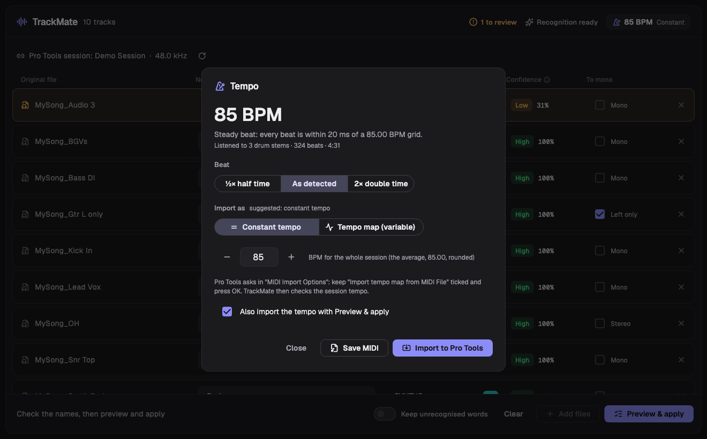
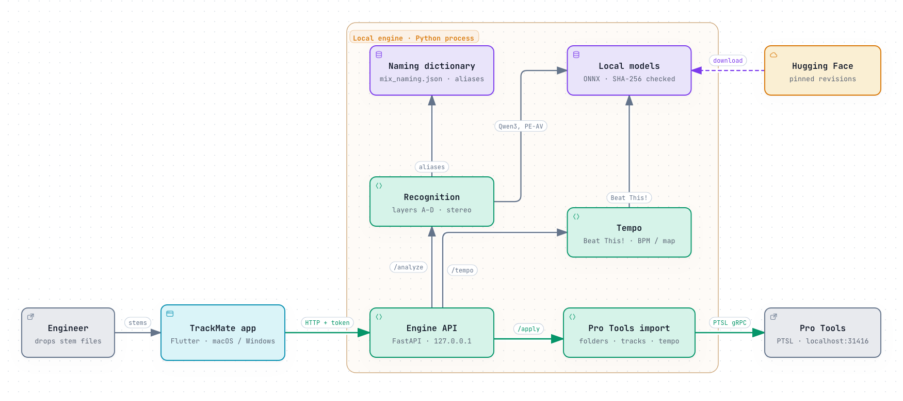

<p align="center"></p>

<p align="center"><b>English</b> | <a href="README.zh-TW.md">繁體中文</a> | <a href="README.ja.md">日本語</a></p>

<p align="center">
  <a href="https://github.com/Hikari-Tsai/TrackMate/releases/latest/download/TrackMate-macos-universal.dmg"></a>
  <a href="https://github.com/Hikari-Tsai/TrackMate/releases/latest/download/TrackMate-windows-x64.zip"></a>
  <br>
  <a href="https://github.com/Hikari-Tsai/TrackMate/releases/latest"></a>
  <a href="https://github.com/Hikari-Tsai/TrackMate/actions/workflows/ci.yml"></a>
  <a href="LICENSE"></a>
</p>

# TrackMate

Before a Pro Tools mix, engineers lose time on chores: stems arrive with inconsistent names full of typos, abbreviations and defaults like `Audio 3`, mono tracks come exported as stereo, and the tempo has to be set by hand. TrackMate does it all in one pass. It recognises every stem, proposes a standard name, category and colour, turns fake stereo back into mono, detects the BPM, and imports everything into Pro Tools with one click. It combines a naming dictionary with state-of-the-art text, audio and beat-tracking models: on real-world track names its first answer is right 96.6 % of the time (98.9 % within its top 5).

Recognition combines rules and AI models:
- **Rules:** a dictionary of common track names and a spelling corrector.
- **Reading the name:** the multilingual text-embedding model Qwen3-Embedding-0.6B understands track names it has never seen.
- **Listening:** Meta's pretrained audio–text model PE-AV (in the same family as CLAP; only the audio encoder, converted to ONNX) handles tracks whose names say nothing.
- **Tempo:** the beat-tracking model Beat This! (CPJKU, ISMIR 2024, converted to ONNX) finds every beat and downbeat in the drum and percussion stems.

TrackMate does not drive Pro Tools by simulating mouse clicks with AppleScript. It uses Avid's official Pro Tools Scripting Library (PTSL), which is far less sensitive to interface changes and keeps working across future versions.


- **Four recognition layers:** known track names → spelling → AI name reading → listening. Chinese, English and Japanese names all work; tracks whose names say nothing (for example `Audio 3`) are recognised from their audio.
- **You decide where it is unsure:** every track shows its top-1 result and a confidence level; a menu lists the top 5, and you can type a name, search all instruments, keep the original name, or change the category and colour.
- **Stereo analysis:** detects fake stereo, one-sided stereo, inverted polarity and delays, and converts to mono where needed.
- **BPM detection:** the BPM is detected on its own and shown in the top right corner. Before every import you choose a constant tempo (the average, rounded), a tempo map that follows every bar, or the session's own tempo; TrackMate imports it with the tracks and checks that the session tempo changed. The tempo is also saved as a MIDI file.
- **Pro Tools integration:** works through PTSL; names are kept unique, and after applying, every track's name, folder and colour are verified.
- **Runs entirely on your computer:** the models are downloaded on first start; after that no network is needed.

---

## Contents
- [Download and install](#download-and-install)
- [Usage](#usage)
- [How it works](#how-it-works)
- [Architecture](#architecture)
- [Building from source and testing](#building-from-source-and-testing)
- [Repository layout](#repository-layout)
- [Research and test reports](#research-and-test-reports)
- [CI/CD](#cicd)
- [Known limitations](#known-limitations)
- [Acknowledgements](#acknowledgements)
- [License](#license)

---

## Download and install

### Requirements
| Item | Requirement |
|---|---|
| macOS | macOS 14 (Sonoma) or later, Apple Silicon or Intel (one universal app) |
| Windows | Windows 10/11 x64 (built in CI, not yet verified on a real machine; see [Known limitations](#known-limitations)) |
| Pro Tools | A version with PTSL (2023.3 or later); tested with Pro Tools 26.4.1. Colouring needs a PTSL with `SetTrackColor` |
| Disk space | About 340 MB for the macOS app (it carries both engines) or 150 MB on Windows, plus about 1.43 GB of models downloaded on first start |

### Install
1. Download the latest version with the buttons at the top, or pick a version on [Releases](https://github.com/Hikari-Tsai/TrackMate/releases):
   - macOS: [`TrackMate-macos-universal.dmg`](https://github.com/Hikari-Tsai/TrackMate/releases/latest/download/TrackMate-macos-universal.dmg) (or `.zip`), for both Apple Silicon and Intel Macs
   - Windows: [`TrackMate-windows-x64.zip`](https://github.com/Hikari-Tsai/TrackMate/releases/latest/download/TrackMate-windows-x64.zip)
2. **macOS:** open the `.dmg`; the window shows TrackMate on the left and the Applications folder on the right. Drag TrackMate onto Applications. The current builds are not notarized by Apple, so the first time, right-click the app and choose **Open**, or run:
   ```bash
   xattr -dr com.apple.quarantine /Applications/TrackMate.app
   ```
3. **Windows:** unzip and run `TrackMate.exe`. If SmartScreen warns you, choose **More info** → **Run anyway**.
4. **First start:** the app downloads the models in the background and shows the progress in its header. Known track names and spelling correction work before the download finishes. Models and settings are stored in:
   - macOS: `~/Library/Application Support/TrackMate`
   - Windows: `%APPDATA%\TrackMate`

## Usage


1. **Open Pro Tools and the session to import into.** The session name and sample rate are shown under the title.
2. **Add stems:** drag audio files or folders into the window, or press **Add audio files**. Supported: WAV, AIFF, MP3, FLAC, M4A, OGG, CAF.
3. **Check the results:**
   - Name-based results appear first; tracks whose names say nothing are then recognised by listening (shown as *Listening…*).
   - Tracks with low confidence are highlighted in orange, and the header shows how many need review. Hover over the confidence column to see how a track was recognised.
4. **Correct:**
   - **New name menu (top 5):** pick another candidate, or choose *Type a name…*, *Search all instruments…* or *Keep original name*. You can also edit the name field directly.
   - **Category:** changing it also switches the colour to that category's default.
   - **Colour swatch:** pick any of the 69 Pro Tools palette colours.
   - **To mono:** pre-ticked from the stereo analysis; you can change it.
   - Instruments you pick from the top 5 are remembered, so the same name is recognised correctly next time.
5. **Keep unrecognised words (off by default):** when off, words that could not be recognised and Pro Tools suffixes (such as `_04-01` or `-TCEx_01`) are removed; turn it on to keep them. Duplicate names get running numbers, for example `Lead Vocal 1`, `Lead Vocal 2`.
6. **Tempo (automatic):** while you check the names, TrackMate detects the BPM in the drum and percussion stems (or bass, guitars, keys and synths when there are none) and shows it in the top right corner. Nothing to press: it is detected again when you add or remove stems.
7. **Press Preview & apply.** Every import goes through these steps:
   - **Tempo:** a window shows the BPM and asks how to set the session tempo. *Constant tempo* sets one BPM, the average rounded, which you can change with − and +. *Tempo map* sets one tempo per bar, so every bar line falls on the downbeat heard in the stems. *Keep session tempo* leaves it as it is. TrackMate suggests constant when every beat lies within 30 ms of one straight grid. If the song was heard in half or double time, pick *½× half time* or *2× double time*. When no beat is found, you can detect again or continue without tempo.
   - **Preview:** which folders will be created, each track's final name, whether it is converted to mono, and the tempo. Nothing is written to Pro Tools until you confirm.
   - **Import:** first the tracks, then the tempo. Pro Tools shows its *MIDI Import Options* dialog; keep *Import tempo map from MIDI File* ticked and press **OK**. TrackMate then reads the session back and checks the tempo.
   - **Result:** every track shows its verification result, and the tempo whether it was set. If it was not (for example the dialog was cancelled), **Import tempo again** imports only the tempo. The tempo is also saved as a MIDI file next to the stems (`TrackMate Tempo 85 BPM.mid`), for other DAWs.




When something goes wrong, the app explains what happened and what to do:


| Situation | Alert | What you can do |
|---|---|---|
| Pro Tools is not running | Pro Tools is not running | Start Pro Tools, then *Try again* |
| No session is open | No session is open in Pro Tools | Open a session, then *Try again* |
| Pro Tools is busy or shows a dialog | Pro Tools is not responding | Close the dialog, then *Try again* |
| Pro Tools quits during the import | Pro Tools stopped during the import | Check the session first (some tracks may already be there), then apply again |
| Files were moved | Files not found (with the list) | During recognition those tracks are removed automatically |
| Nothing dropped is audio | No audio files found | — |
| The engine stopped | The TrackMate engine stopped | *Restart engine* (your list is kept) |
| No beat in the stems (silence, no rhythm stems) | No steady beat found | Add the drum or rhythm stems, or set the tempo in Pro Tools |
| The tempo model is still downloading | The tempo model is still downloading | Wait until the download in the header finishes |

## How it works

### 1. Name preprocessing
Code: [`engine/stem_engine/names.py`](engine/stem_engine/names.py)

1. **Normalisation:** Unicode NFKC; file extension, BPM, key and dates are removed.
2. **Pro Tools suffixes are removed** (repeatedly, until none is left):
   - take and clip numbers such as `_03` or `_04-01`;
   - playlist numbers such as `.04_09`;
   - duplicate marks such as `.dup1`;
   - AudioSuite tags: `-Tag` followed by a take number, when the dictionary does not know the word, such as `-TCEx_01`.
3. **Tokenisation:** split at separators, case changes (`SnareTop`), letter/digit boundaries and CJK/Latin boundaries. The original spelling is kept so it can be reused verbatim.
4. **Batch prefixes and suffixes are removed:** text shared by every file in the batch is usually the song title (for example `MySong_` or `_Track1`) and is removed, except words the dictionary knows.
5. **DAW default names:** names such as `Audio 7`, `Untitled` or `オーディオ 3` say nothing about the instrument; they go straight to audio recognition, and the DAW's counter is not kept.

### 2. Four recognition layers
| Layer | Method | Code | Accepted when |
|---|---|---|---|
| A Known names | [`kb/mix_naming.json`](kb/mix_naming.json): 14 categories, 191 instruments, about 2,100 English, Chinese and Japanese aliases and abbreviations, plus the aliases you taught it | [`textmatch.py`](engine/stem_engine/textmatch.py) | A match is accepted (high confidence) |
| B Spelling | rapidfuzz WRatio on the words nothing matched | same | Score ≥ 90, length ≥ 4, at least 5 points ahead of the runner-up, and similar length (medium confidence) |
| C AI name reading | Qwen3-Embedding-0.6B (ONNX, 8-bit). Queries and index carry the same instruction; the index also contains "not an instrument" anchors | [`embed.py`](engine/stem_engine/embed.py) | Similarity ≥ 0.86, lead ≥ 0.03, and above the anchors (medium confidence); 0.62–0.86 goes to layer D to confirm the category |
| D Listening | PE-AV small audio encoder (ONNX, 8-bit) on the loudest segments, compared with 16 class prototypes (12 categories, click, full mix, speech, noise); SigLIP logits with a softmax | [`audio.py`](engine/stem_engine/audio.py) | Best class probability ≥ 0.15 (category only, low confidence) |

**Dictionary matching details:**
- The longest phrase wins (`bass drum` matches kick, not bass).
- Abbreviations must be whole words; Chinese and Japanese terms match as substrings, longest first.
- Words that are both an instrument and a modifier (such as `room` or `dbl`) are modifiers next to another instrument word, and instruments only when they stand alone.
- A single letter counts only when it is the whole name.
- When several categories appear in one name, the audio decides.

**Merging ([`pipeline.py`](engine/stem_engine/pipeline.py)):**
- When the dictionary finds only a family word and the name has more words (`Synthesized Bass`), and the AI's best match is a more specific instrument of the same family, the AI's answer is used (A+C).
- In the AI's grey zone, a result is accepted only when the audio agrees on the category (C+D).
- When nothing works, the category is OTHER, the original name is kept and the track is flagged for review.
- Top-5 candidates come, in order, from: the decision → the dictionary's ambiguous options → the AI ranking (re-ordered with the audio category probabilities) → the audio categories' representative instruments. Scores are shown as percentages, but their meaning depends on the source: 100 % for the dictionary, similarity for the AI, probability for the audio.

### 3. Naming
- **Form:** standard name + modifiers + number, for example `Snare Bottom 2`.
  - Placement modifiers are standardised: L/R/C, Top/Bottom, In/Out, DI/Amp.
  - Other modifiers keep your spelling, for example `Fuzz`.
- **Keep mode:** with *Keep unrecognised words* on, unrecognised words and Pro Tools suffixes are added back.
- **Duplicates:** names repeated in the batch get running numbers; when a name already ends in a number, `-1`/`-2` is used.
- **Names taken in the session:** names that already exist in Pro Tools become ` 2`, ` 3`, … (case-sensitive, as in Pro Tools).

### 4. Stereo analysis
Code: [`stereo_analysis/stereo_analyzer.py`](stereo_analysis/stereo_analyzer.py)

- **Principle:** whatever the pan position, pan law or polarity, a single source puts every (L, R) sample on one line through the origin, so the decision uses the rank-1 residual of the 2×2 covariance matrix, `10·log10(λmin/λmax)`.
- **Mono recovery:** the principal eigenvector gives pan position and polarity; projecting onto it gives a mono version that never cancels.
- **Only active frames:** statistics use only frames with sound, so silence and fades do not bias the result.
- **Other checks:** cross-correlation finds delayed mono.

Details: [stereo report](docs/reports/stereo-analysis.md).

### 5. Import into Pro Tools (`/apply`)
Code: [`engine/stem_engine/apply.py`](engine/stem_engine/apply.py), [`protools.py`](engine/stem_engine/protools.py)

1. **Folders:** one Basic Folder per category, in category order; a folder that already exists in the session is reused.
2. **Import:** file by file (ConvertAudio, so everything is converted to the session's sample rate), each time after selecting the previous track, so the order inside the folder matches the list. Files to be converted to mono are converted to a temporary file first.
3. **Rename:** the new track is found from the track IDs before and after the import and renamed at once, to a name already checked to be unique.
4. **Colour:** folders and tracks are coloured in groups by colour.
5. **Verification:** the track list is read again and each track's name, folder and colour are checked.

PTSL currently has no command to create buses, so output routing is not set automatically. See the [integration report](docs/reports/pro-tools-integration.md).

### 6. Tempo (`/tempo`)
Code: [`engine/stem_engine/tempo.py`](engine/stem_engine/tempo.py) (engine), [`app_state.dart`](app/lib/app_state.dart) and [`tempo_dialog.dart`](app/lib/ui/tempo_dialog.dart) (app)

**When it runs**
- The app starts the detection in the background as soon as the stems are recognised, and shows the result in the top right corner.
- It is detected again when stems are added or removed. A changed category is picked up when you press Preview & apply.
- A detection that finds no beat, or that waits for the model download, raises no alert. The tempo step of Preview & apply explains it.

**Which stems are used**

The categories are the ones shown in the list, including your own changes. The first row that applies is used, and all of its stems are mixed together:

| Order | When | Stems used |
|---|---|---|
| 1 | There is at least one drum or percussion stem | All **Drums** and **Percussion** stems |
| 2 | No drums or percussion | All **Bass**, **Guitars**, **Keys** and **Synths** stems |
| 3 | None of these either | All stems |

**Mixing**
- Each stem is read as mono at 22.05 kHz, and the stems are added sample by sample from their start, as they are imported at the session start.
- The level is kept, and only lowered when the sum would clip. Beat This!'s spectrogram depends on the level, and raising a quiet mix to full scale added 8 false beats in a 25-second test.
- At most 20 minutes are read. Less than 2 seconds, or silence, gives "no steady beat".

**Beat tracking:** Beat This! `final0` (ONNX, FP32), as in the original project:
1. **Spectrogram:** centred frames with reflect padding, periodic Hann window, n_fft 1024, hop 441 (50 frames per second), magnitude / √1024, 128 Slaney mel bands, then log(1 + 1000·x).
2. **Model:** chunks of 1500 frames (30 s) overlapping by 12 frames. The 6 frames at each chunk edge are dropped, and where chunks overlap the earlier one wins.
3. **Peak picking:** a frame is a beat (or downbeat) when its logit is above 0 and the largest within ±3 frames; peaks one frame apart are merged. Each downbeat is moved to the nearest beat.
4. **Between frames:** each peak is refined with a parabola through it and its two neighbours, so beat times are not multiples of 20 ms. Otherwise, at 120 BPM, the tempo of single beats would jump between 115 and 125 BPM.

**Clean-up:** the main beat gap is the median of all gaps.
- A beat closer than 0.7 gaps to the previous beat is dropped. This happens when a passage, such as an intro of hi-hats, was tracked in double time.
- Where the gap to the next beat is several main gaps long, because the stems pause, the missing beats are put back evenly.
- Downbeats that were dropped move to the nearest remaining beat.
- Because of this, a tempo change of more than about 30 % within one song is not followed.

**The figures:** with fewer than 5 beats there is no tempo.

| Figure | How it is computed |
|---|---|
| Steady? | A straight line is fitted through all beats (beat number → time). Steady when every beat lies within **30 ms** of it |
| BPM | Steady: 60 / the line's slope. Otherwise the average: 60 × (beats − 1) / (last beat − first beat), so fast passages do not count more than slow ones |
| Slowest / fastest bar | One tempo per bar, between detected downbeats (every 4 beats when there are none) |
| Meter | The number of beats per bar, when every bar has the same number; written as x/4 |
| Suggestion | Steady → constant tempo; otherwise → tempo map |

**The choice before the import** (tempo step of Preview & apply):
- **Constant tempo:** the BPM rounded to a whole number, which you can change between 20 and 400.
- **Tempo map:** one tempo per bar, as above.
- **Keep session tempo:** nothing is imported.
- **½× half time** keeps every other beat; **2× double time** adds a beat between each pair. The detected meter is then not used, so the file says 4/4.

**MIDI file:** type 0, 480 ticks per quarter note, only tempo and time-signature events.
- **Constant:** one tempo at tick 0.
- **Tempo map:** the first tempo starts at tick 0 and also covers the time before the first beat, so the first beat lands at its own time from the session start. After that, one tempo per bar, so every bar line falls on the downbeat heard in the stems.
- The file is saved next to the stems (`TrackMate Tempo 85 BPM.mid` or `TrackMate Tempo Map (avg 85 BPM).mid`).

**Import into Pro Tools**
- PTSL has no tempo command. Importing a MIDI file through PTSL makes Pro Tools show its *MIDI Import Options* dialog, where *Import tempo map from MIDI File* replaces the session tempo. On macOS, TrackMate brings Pro Tools to the front for this click. It never clicks for you.
- The tempo is imported after the tracks.
- PTSL reports success for OK and for Cancel alike, so TrackMate checks the result. It moves the timeline selection to the last beat, reads that position in Bars|Beats, puts the selection back, and compares the position with its own tempo map (tolerance 0.05 beats).
- If they differ, the result says the tempo was not changed and offers **Import tempo again**, which imports only the tempo.

**Accuracy:** same beats as the original PyTorch model; 85 BPM stems read as 85.00. The same drums sped up section by section gave a tempo map of 76.5, 85.0, 93.6 and 102.0 BPM (true: 76.5, 85, 93.5, 102). Details: [tempo report](docs/reports/tempo-detection.md).

## Architecture

<picture>
  <source media="(prefers-color-scheme: dark)" srcset="docs/images/architecture-dark.png">
  
</picture>

- **Start-up:** the app starts its bundled engine as a child process and reads the port and token from the engine's first output line or from `engine.json`.
- **API security:** local connections only; a new token on every start; requests whose Host is not local are refused. Endpoints are described in [`engine/README.md`](engine/README.md).

## Building from source and testing

Tools:
- [uv](https://docs.astral.sh/uv/) (Python 3.12).
- [Flutter 3.47.8](https://docs.flutter.dev/).
- Xcode on macOS; Visual Studio 2022 with C++ desktop development on Windows.
- Pro Tools on the machine for the integration tests.

```bash
# Engine
cd engine
uv sync --group dev
uv run pytest -q                       # 93 tests (tests that need the models skip themselves)
uv run stem-engine                     # starts; first line {"port", "token"}; downloads the models

# Stereo analysis
cd ../stereo_analysis
../engine/.venv/bin/python -m pytest -q   # 27 tests

# App (development mode, using the engine environment above)
cd ../app
flutter test                            # 25 tests; add --exclude-tags golden to skip screenshot comparisons
flutter run -d macos --dart-define=ENGINE_CMD=$PWD/../engine/.venv/bin/stem-engine
```

**Packaging the app for distribution:**
- macOS: [`scripts/package-macos.sh`](scripts/package-macos.sh). It builds an Apple Silicon engine and an Intel engine (with an x86_64 Python under Rosetta 2, so it runs on an Apple Silicon Mac) and puts both in one universal app.
- Windows: [`scripts/package-windows.ps1`](scripts/package-windows.ps1).
- Both build the engine, smoke-test it, build the app, put the engine inside, and write the result to `dist/`.

More in [`engine/README.md`](engine/README.md) and [`app/README.md`](app/README.md).

## Repository layout

| Path | Contents |
|---|---|
| [`app/`](app) | Flutter desktop app: [UI](app/lib/ui), [state](app/lib/app_state.dart), [engine launcher](app/lib/engine/engine_launcher.dart), [macOS native code](app/macos/Runner/MainFlutterWindow.swift), [Windows native code](app/windows/runner/flutter_window.cpp), [tests](app/test) |
| [`engine/`](engine) | Local engine: [recognition](engine/stem_engine), [API](engine/stem_engine/api.py), [Pro Tools](engine/stem_engine/protools.py), [model manifest](engine/stem_engine/data/model_manifest.json), [tests](engine/tests), [evaluation tools](engine/tools), [packaging](engine/packaging) |
| [`stereo_analysis/`](stereo_analysis) | Stereo/mono analysis and its tests |
| [`kb/mix_naming.json`](kb/mix_naming.json) | Instrument naming dictionary (categories, instruments, aliases, abbreviations, Chinese and Japanese, modifiers, ambiguous terms) |
| [`experiments/`](experiments) | Research: [text-embedding model comparison](experiments/c_layer_embedding), [instrument recognition evaluation](experiments/instrument_zeroshot) |
| [`tools/`](tools) | [Qwen ONNX export](tools/qwen_onnx), [PE-AV ONNX export](tools/peav_onnx), [Pro Tools probes](tools/ptsl_m0), [PE-AV instrument recognition demo](tools/peav_space) (Hugging Face Space source: 169 instruments and sounds; [`app.py`](tools/peav_space/space/app.py), [labels and prompts](tools/peav_space/space/labels.json), [prototype builder](tools/peav_space/build_prototypes.py)) |
| [`scripts/`](scripts) | macOS and Windows packaging scripts |
| [`docs/`](docs) | [Research and test reports](docs/reports), [screenshots](docs/images) |
| [`.github/workflows/`](.github/workflows) | [CI](.github/workflows/ci.yml), [packaging and release](.github/workflows/package.yml) |

## Research and test reports

Index: [`docs/reports/`](docs/reports/README.md) (the reports are written in Traditional Chinese).

| Report | Key findings |
|---|---|
| [Text-embedding model comparison](experiments/c_layer_embedding/REPORT.md) | Qwen3-Embedding is best on Chinese, bge-m3 on Japanese; top-5 coverage is much higher than top-1, so the model works well as a candidate generator |
| [Instrument recognition evaluation](experiments/instrument_zeroshot/REPORT.md) | PE-AV small reaches 96.2 % category accuracy on real solo recordings (97.5 % balanced) |
| [Model export and quantisation](docs/reports/model-export.md) | Both ONNX models stay at cosine ≥ 0.996 against PyTorch; Qwen 8-bit takes 54 ms per query on CPU |
| [Stereo/mono analysis](docs/reports/stereo-analysis.md) | All 14 synthetic cases (pan, one-sided, inverted polarity, delay, reverb, …) are classified correctly |
| [Engine evaluation](docs/reports/engine-evaluation.md) | Real track names: top-1 96.6 %, top-5 98.9 %; automatic renames 97.0 % precise, no non-instrument name renamed |
| [Pro Tools integration](docs/reports/pro-tools-integration.md) | 10 tracks imported, renamed and coloured in 8.2 s, all verified |
| [Tempo detection](docs/reports/tempo-detection.md) | Same beats as the PyTorch model; 85 BPM stems read as 85.00; tempo maps within 0.15 BPM; the Pro Tools tempo checked after import |
| [Desktop app testing](docs/reports/app-testing.md) | Real app + engine + Pro Tools end to end in 35–38 s |

## CI/CD

| Workflow | Runs on | What it does |
|---|---|---|
| [CI](.github/workflows/ci.yml) | Push to `main`, pull requests | Engine and stereo-analysis tests, `flutter analyze`, app tests (without screenshot comparisons) |
| [Package](.github/workflows/package.yml) | `v*` tags, manual runs, and pushes to `main` that change how the apps are built (packaging scripts, dependencies, the macOS/Windows projects, the workflow) | Builds and smoke-tests the engines (macOS: Apple Silicon and Intel, packed into one universal app; Windows x64), builds the apps and uploads them as workflow artifacts. A `v*` tag also creates a GitHub release with the installers and install instructions ([template](.github/release-notes.md)) |

To publish a release:
```bash
git tag v0.1.0
git push origin v0.1.0
```

## Known limitations
- **Output routing:** PTSL cannot create buses yet, so TrackMate only groups tracks into folders; set up routing yourself.
- **Windows:** built and packaged in CI but not yet used on a real machine; dragging files shows no hover highlight.
- **macOS:** builds are ad-hoc signed and not notarized by Apple. The Intel engine uses onnxruntime 1.23.2, the last release with an Intel macOS build; it gives the same evaluation results as the Apple Silicon engine, but has so far been tested under Rosetta 2, not on a real Intel Mac.
- **Thresholds:** current values are starting points from small test sets and still need calibration on real sessions.
- **Dictionary:** Chinese and Japanese spellings that are not in the dictionary are learnt mainly by extending it and from your corrections.
- **Tempo:** beats are taken as quarter notes, so a song felt in half or double time needs the ½× or 2× choice; tempo changes of more than about 30 % within one song are not followed; meters other than x/4 are written as x/4. The tempo map starts at the first detected beat, not at a bar line. Pro Tools asks for one click (*OK* in *MIDI Import Options*) for each import.
- **Audio recognition:** category only, and verified on solo recordings only. A 10-second segment takes about 2.8 s on CPU, so it runs only for tracks whose names say nothing.

## Acknowledgements

TrackMate is built on the following open-source software, models, datasets and fonts. Many thanks to their authors and communities. The licences of the original projects apply.

### Models
| Model | Authors | Licence | Use |
|---|---|---|---|
| [Qwen3-Embedding-0.6B](https://huggingface.co/Qwen/Qwen3-Embedding-0.6B) | Qwen team (Alibaba) | Apache-2.0 | Layer C, AI name reading (ONNX: [aaatmy/Qwen3-Embedding-0.6B-ONNX](https://huggingface.co/aaatmy/Qwen3-Embedding-0.6B-ONNX)) |
| [PE-AV small](https://huggingface.co/facebook/pe-av-small) (Perception Encoder Audio-Visual) | Meta FAIR | Apache-2.0 | Layer D, listening (ONNX: [aaatmy/pe-av-small-audio-ONNX](https://huggingface.co/aaatmy/pe-av-small-audio-ONNX)) |
| [Beat This!](https://github.com/CPJKU/beat_this) (`final0`) | Foscarin, Schlüter, Widmer (JKU Linz) | MIT | Tempo: beats and downbeats (ONNX: [aaatmy/beat-this-onnx](https://huggingface.co/aaatmy/beat-this-onnx)) |
| [multilingual-e5-small](https://huggingface.co/intfloat/multilingual-e5-small) | Microsoft | MIT | Research comparison |
| [bge-m3](https://huggingface.co/BAAI/bge-m3) | BAAI | MIT | Research comparison |
| [larger_clap_general](https://huggingface.co/laion/larger_clap_general) | LAION | Apache-2.0 | Research comparison |

### Datasets
| Dataset | Licence | Use |
|---|---|---|
| [NSynth](https://magenta.tensorflow.org/datasets/nsynth) (Google Magenta) | CC BY 4.0 | Instrument recognition evaluation |
| [Medley-solos-DB](https://zenodo.org/records/3464194) (Lostanlen & Cella) | CC BY 4.0 | Instrument recognition evaluation, audio threshold |

### Engine (Python)
| Package | Licence |
|---|---|
| [NumPy](https://numpy.org/) | BSD-3-Clause |
| [python-soundfile](https://github.com/bastibe/python-soundfile) (bundles [libsndfile](https://libsndfile.github.io/libsndfile/), LGPL-2.1) | BSD-3-Clause |
| [python-soxr](https://github.com/dofuuz/python-soxr) ([libsoxr](https://sourceforge.net/projects/soxr/)) | LGPL-2.1-or-later |
| [RapidFuzz](https://github.com/rapidfuzz/RapidFuzz) | MIT |
| [ONNX Runtime](https://onnxruntime.ai/) | MIT |
| [Hugging Face Tokenizers](https://github.com/huggingface/tokenizers) | Apache-2.0 |
| [FastAPI](https://fastapi.tiangolo.com/), [Pydantic](https://docs.pydantic.dev/) | MIT |
| [Starlette](https://www.starlette.io/), [Uvicorn](https://www.uvicorn.org/) | BSD-3-Clause |
| [py-ptsl](https://github.com/iluvcapra/py-ptsl) (Jamie Hardt) | BSD-3-Clause |
| [gRPC](https://grpc.io/) (grpcio) | Apache-2.0 |
| [Protocol Buffers](https://protobuf.dev/) | BSD-3-Clause |
| [PyInstaller](https://pyinstaller.org/) (packaging; the bootloader exception allows distributing bundled programs) | GPL-2.0 with bootloader exception |
| [pytest](https://pytest.org/), [HTTPX](https://www.python-httpx.org/) (tests) | MIT, BSD-3-Clause |
| [uv](https://docs.astral.sh/uv/), [Hatchling](https://hatch.pypa.io/), [dmgbuild](https://github.com/dmgbuild/dmgbuild) (build tools) | MIT / Apache-2.0, MIT, MIT |

Research and model export also used [PyTorch](https://pytorch.org/) (BSD-3-Clause), [Transformers](https://github.com/huggingface/transformers), [Sentence Transformers](https://www.sbert.net/), [timm](https://github.com/huggingface/pytorch-image-models) (Apache-2.0), [librosa](https://librosa.org/) (ISC) and [Pillow](https://python-pillow.org/) (MIT-CMU). The PE-AV demo also uses [Gradio](https://www.gradio.app/), [huggingface_hub](https://github.com/huggingface/huggingface_hub) (Apache-2.0) and [FFmpeg](https://ffmpeg.org/) (LGPL-2.1+, for decoding other audio formats).

### App (Flutter)
| Item | Licence |
|---|---|
| [Flutter](https://flutter.dev/), [http](https://pub.dev/packages/http) | BSD-3-Clause |
| [lucide_icons_flutter](https://pub.dev/packages/lucide_icons_flutter) ([Lucide](https://lucide.dev/) icons, ISC) | MIT |
| [Geist, Geist Mono](https://github.com/vercel/geist-font) (Vercel, v1.8.2; licence in [`app/assets/fonts/Geist-OFL.txt`](app/assets/fonts/Geist-OFL.txt)) | SIL OFL 1.1 |

### References
```bibtex
@article{qwen3embedding,
  title   = {Qwen3 Embedding: Advancing Text Embedding and Reranking Through Foundation Models},
  author  = {Zhang, Yanzhao and Li, Mingxin and Long, Dingkun and Zhang, Xin and Lin, Huan and Yang, Baosong and Xie, Pengjun and Yang, An and Liu, Dayiheng and Lin, Junyang and Huang, Fei and Zhou, Jingren},
  journal = {arXiv preprint arXiv:2506.05176},
  year    = {2025}
}
@misc{vyas2025peav,
  title  = {Pushing the Frontier of Audiovisual Perception with Large-Scale Multimodal Correspondence Learning},
  author = {Vyas, Apoorv and Chang, Heng-Jui and Yang, Cheng-Fu and Huang, Po-Yao and Gao, Luya and Richter, Julius and Chen, Sanyuan and Le, Matt and Doll{\'a}r, Piotr and Feichtenhofer, Christoph and Lee, Ann and Hsu, Wei-Ning},
  year   = {2025},
  eprint = {2512.19687},
  archivePrefix = {arXiv}
}
@inproceedings{foscarin2024beatthis,
  title     = {Beat this! Accurate beat tracking without {DBN} postprocessing},
  author    = {Foscarin, Francesco and Schl{\"u}ter, Jan and Widmer, Gerhard},
  booktitle = {Proceedings of the 25th International Society for Music Information Retrieval Conference (ISMIR)},
  year      = {2024}
}
@inproceedings{wu2023clap,
  title     = {Large-scale Contrastive Language-Audio Pretraining with Feature Fusion and Keyword-to-Caption Augmentation},
  author    = {Wu, Yusong and Chen, Ke and Zhang, Tianyu and Hui, Yuchen and Berg-Kirkpatrick, Taylor and Dubnov, Shlomo},
  booktitle = {ICASSP},
  year      = {2023}
}
@article{wang2024me5,
  title   = {Multilingual E5 Text Embeddings: A Technical Report},
  author  = {Wang, Liang and Yang, Nan and Huang, Xiaolong and Yang, Linjun and Majumder, Rangan and Wei, Furu},
  journal = {arXiv preprint arXiv:2402.05672},
  year    = {2024}
}
@article{chen2024bgem3,
  title   = {BGE M3-Embedding: Multi-Lingual, Multi-Functionality, Multi-Granularity Text Embeddings Through Self-Knowledge Distillation},
  author  = {Chen, Jianlv and Xiao, Shitao and Zhang, Peitian and Luo, Kun and Lian, Defu and Liu, Zheng},
  journal = {arXiv preprint arXiv:2402.03216},
  year    = {2024}
}
@inproceedings{engel2017nsynth,
  title     = {Neural Audio Synthesis of Musical Notes with WaveNet Autoencoders},
  author    = {Engel, Jesse and Resnick, Cinjon and Roberts, Adam and Dieleman, Sander and Eck, Douglas and Simonyan, Karen and Norouzi, Mohammad},
  booktitle = {ICML},
  year      = {2017}
}
@inproceedings{lostanlen2016medleysolos,
  title     = {Deep Convolutional Networks on the Pitch Spiral for Musical Instrument Recognition},
  author    = {Lostanlen, Vincent and Cella, Carmine-Emanuele},
  booktitle = {ISMIR},
  year      = {2016}
}
```

### Trademarks
Pro Tools, AudioSuite and Avid are trademarks of Avid Technology, Inc. TrackMate is not affiliated with or endorsed by Avid. The Pro Tools Scripting Library (PTSL) is provided by Avid. Apple, macOS and the Apple logo are trademarks of Apple Inc.; Windows and the Windows logo are trademarks of Microsoft Corporation. They are used only to show which download is for which system.

## License
TrackMate's source code, documentation and naming dictionary are released under the [MIT License](LICENSE).

The pretrained models are **not** covered by the MIT License. Qwen3-Embedding-0.6B and PE-AV small are under the Apache License 2.0, and Beat This! under its own MIT License (© JKU Linz); TrackMate downloads them with a copy of their licence, and the files derived from PE-AV (`peav_prototypes.npz`, `prototypes.npz`) are under the same licence. Third-party models, datasets, fonts and libraries, and the changes made to the models, are listed in [THIRD_PARTY_NOTICES.md](THIRD_PARTY_NOTICES.md).
